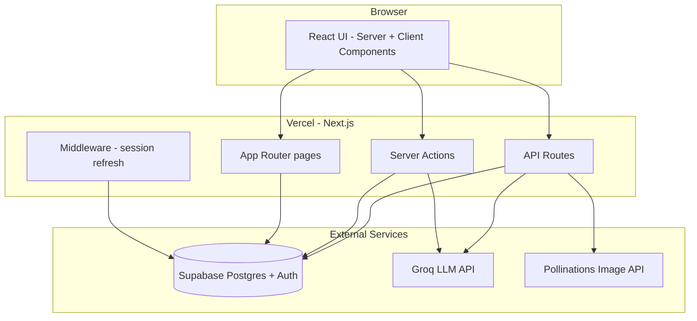

# AI Publishing Studio — Technical One-Pager

**For:** Mentor / lead programmer onboarding  
**Repo:** [github.com/ayanhs/Library](https://github.com/ayanhs/Library)  
**Deploy:** Vercel (auto-deploys on push to `main`)  
**Last updated:** June 2026

---

## What It Is

**AI Publishing Studio** is a web app that helps authors go from a story idea to a publishable manuscript. Users create books, get an AI-generated story blueprint, write chapters with AI assistance, maintain a Story Bible, use an AI editor, generate cover art, and export PDF / DOCX / EPUB.

Target users: aspiring authors who want guided, AI-assisted book creation without learning professional writing tools.

---

## How It Was Built

This project was **vibe coded** — built iteratively in Cursor with an AI pair programmer, feature by feature, without a formal spec or sprint plan. That means:

- Features were added when they felt useful, not from a product roadmap
- Patterns are mostly consistent (Next.js App Router conventions) but not enforced by lint rules or architecture docs
- SQL migrations live as hand-written scripts in `supabase/`, run manually in the Supabase SQL Editor — **not** managed by Supabase CLI or a migration runner
- There are **no automated tests** and **no CI** beyond Vercel’s build-on-push
- The README is outdated (still references an early MVP scope)

**What works well:** The app is fully functional, deployed, and has real auth, RLS, rate limits, admin tooling, and export pipelines. The code is TypeScript throughout with Zod validation on inputs.

**What a lead programmer should expect:** Technical debt is manageable but real. The highest-value early work is documentation alignment, migration tooling, test coverage for critical paths, and scaling decisions (especially cover image storage).

---

## Tech Stack

| Layer | Choice | Notes |
|-------|--------|-------|
| Framework | **Next.js 16** (App Router) | Build uses `--webpack` (required for pdfkit; Turbopack breaks the build) |
| UI | **React 19**, **Tailwind CSS 3** | Server Components + Client Components mix |
| Language | **TypeScript 5.8** | Strict typing; Zod for runtime validation |
| Database & Auth | **Supabase** (Postgres + Auth + RLS) | `@supabase/ssr` for cookie-based sessions |
| Text AI | **Groq API** (`llama-3.3-70b-versatile`) | OpenAI-compatible client in `src/lib/ai/groq.ts` |
| Image AI | **Pollinations** (Flux) | Free legacy tier primary; optional `POLLINATIONS_API_KEY` for premium fallback |
| Export | **pdfkit**, **docx**, **epub-gen-memory** | Generated server-side in API routes |
| Icons | lucide-react | |
| Node | **≥ 20** | |
| Hosting | **Vercel** | Previously Netlify; switched for better Next.js support |

---

## Architecture (High Level)



**Request flow patterns:**

1. **Server Components / Server Actions** — Most book CRUD, blueprint, chapters, story bible, editor logic. Data fetched and mutated via Supabase server client with RLS enforcing ownership.
2. **API routes** — Long-running or binary operations: cover generation (`/api/book/[id]/covers/*`), export download (`/api/book/[id]/export`), AI usage summary (`/api/ai/usage`).
3. **Middleware** — Refreshes Supabase session on every request; protects `/dashboard` and `/admin`.

---

## Repository Structure

```
Library/
├── src/
│   ├── app/                          # Next.js App Router
│   │   ├── (auth)/                   # login, signup, forgot-password
│   │   ├── auth/callback/            # Supabase email/OAuth redirect handler
│   │   ├── dashboard/                # user home + per-book workflow pages
│   │   │   └── book/[id]/            # blueprint, chapters, story-bible, editor, export
│   │   ├── admin/                    # admin console (stats, feedback, AI monitor)
│   │   └── api/                      # covers, export, ai usage
│   ├── components/                   # UI by feature (books, blueprint, editor, export, admin…)
│   ├── lib/                          # Business logic (the “backend”)
│   │   ├── supabase/                 # client, server, middleware, auth-url helpers
│   │   ├── ai/                       # Groq client + prompt builders
│   │   ├── ai-usage/                 # daily limits, rate limits, guard, logging
│   │   ├── books/, chapters/, blueprint/, story-bible/, editor/
│   │   ├── covers/                   # Pollinations integration + prompt generation
│   │   ├── export/                   # PDF, DOCX, EPUB generators
│   │   ├── admin/, feedback/
│   │   └── validations/              # Zod schemas
│   └── middleware.ts
├── supabase/                         # Manual SQL setup scripts (run in order — see below)
├── scripts/clean-dev.mjs             # Clears .next cache (OneDrive sync issues)
├── .env.local.example
└── package.json
```

**Conventions a new dev should follow:**

- Server Actions live in `*/actions.ts` next to the feature module
- Supabase queries in `*/queries.ts`
- Shared types in `*/types.ts`
- `@/` path alias maps to `src/`

---

## User Workflow (Product Flow)

```
Sign up → Create book (metadata + story prompt)
       → Generate & approve Story Blueprint (AI architect)
       → Write chapters (AI-assisted generation + manual edit)
       → Story Bible (characters, locations, timeline — AI-generated from manuscript)
       → AI Editor (rewrite, expand, tone adjustments)
       → Cover art (3 options per batch, select one)
       → Export (PDF / DOCX / EPUB with optional embedded cover)
```

**Publishing gate:** Blueprint must be approved before chapters and covers unlock (`setup-publishing-workflow.sql`).

---

## Database Overview

All tables use **Row Level Security (RLS)** — users only see their own data. Admin operations use `security definer` RPCs gated by `is_admin()`.

| Table / area | Purpose |
|--------------|---------|
| `profiles` | Extends `auth.users` (name, email); auto-created on signup |
| `books` | Book metadata, genre, prompts, status |
| `chapters` | Chapter titles + content |
| `story_blueprints` | JSON blueprint per book (one-to-one) |
| `story_bibles` | JSON story bible per book |
| `book_covers` | Cover options; **`image_data` stored as base64 in Postgres** |
| `export_metadata` | Last export settings per book |
| `feedback` | In-app feedback submissions |
| `ai_settings` | Global AI kill switch |
| `ai_usage_daily` | Per-user daily usage counters by feature |
| `ai_request_log` | Request audit log for admin monitor |

**SQL setup order** (run in Supabase SQL Editor):

1. `schema.sql`
2. `setup-books.sql`
3. `setup-blueprints.sql`
4. `setup-publishing-workflow.sql`
5. `setup-story-bible.sql`
6. `setup-editor.sql`
7. `setup-export.sql`
8. `setup-export-covers.sql`
9. `setup-admin.sql`
10. `setup-feedback.sql`
11. `setup-ai-limits.sql`
12. `setup-admin-users.sql`

There is no migration history table — scripts use `create if not exists` / `drop policy if exists` for idempotency.

---

## AI Integrations

### Text (Groq)

- **Model:** `llama-3.3-70b-versatile` (override via `GROQ_MODEL`)
- **Used for:** Blueprint generation, chapter writing, story bible, editor rewrites, cover prompt generation (text step before images)
- **Client:** OpenAI SDK pointed at Groq’s base URL (`src/lib/ai/groq.ts`)

### Images (Pollinations)

- **Primary:** Free legacy Flux endpoint (no API key required)
- **Fallback:** Premium Pollinations API if `POLLINATIONS_API_KEY` is set and free tier returns 402
- **Flow:** Groq generates 3 distinct cover prompts → each prompt sent to Pollinations → images returned as base64 → stored in `book_covers`
- **Phased API:** Cover generation uses a multi-step route to stay within Vercel’s ~10s function timeout on Hobby tier

### Usage Limits (`src/lib/ai-usage/`)

| Feature | Daily limit (per user) |
|---------|------------------------|
| Chapter generation | 10 |
| Story Bible | 5 |
| AI Editor | 20 |
| Cover art batches | 3 (each batch = 3 image options) |

Additional guards:
- **Rate limit:** 5 requests/minute, 20/hour (all AI features combined)
- **Cover cooldown:** 12 seconds between successful batches
- **Kill switch:** Admin can disable all AI globally via `ai_settings`
- **Credit consumption:** Cover daily credit is only charged when all 3 images in a batch succeed (not on failure)

Blueprint generation is logged but has **no daily cap** currently.

---

## Auth & Security

- **Supabase Auth** — email/password signup with email confirmation
- **Callback route:** `/auth/callback` exchanges code for session
- **Redirect URLs:** Configured in Supabase dashboard + `src/lib/supabase/auth-url.ts` uses `NEXT_PUBLIC_SITE_URL` as fallback (fixes localhost links in production)
- **Admin:** Single hardcoded email (`shuklaayanh@gmail.com`) in both `src/lib/admin/constants.ts` and SQL `is_admin()` function — **needs env-based config before multi-admin**
- **API keys:** All secrets server-side only; never exposed to client
- **RLS:** Primary authorization layer; server actions assume authenticated user from Supabase session

---

## Deployment & Environment

### Vercel

- Connected to GitHub repo; pushes to `main` trigger production deploy
- Build command: `npm run build` → runs `next build --webpack`
- Set all env vars in Vercel project settings (same as `.env.local`)

### Required Environment Variables

| Variable | Required | Purpose |
|----------|----------|---------|
| `NEXT_PUBLIC_SUPABASE_URL` | Yes | Supabase project URL |
| `NEXT_PUBLIC_SUPABASE_ANON_KEY` | Yes | Supabase anon key |
| `GROQ_API_KEY` | Yes | Text AI |
| `NEXT_PUBLIC_SITE_URL` | Recommended | Auth redirect fallback (e.g. `https://your-app.vercel.app`) |
| `GROQ_MODEL` | No | Default: `llama-3.3-70b-versatile` |
| `POLLINATIONS_API_KEY` | No | Premium cover fallback only |

### Local Development

```bash
npm install
cp .env.local.example .env.local   # fill in values
npm run dev                        # or npm run dev:clean if .next cache issues (OneDrive)
```

App runs at `http://localhost:3000`.

---

## Admin Console

Route: `/admin` (requires admin email login)

Features:
- Overview stats (users, books, recent signups with name/email)
- Feedback inbox
- AI usage monitor (requests, failures, per-feature breakdown, kill switch)

---

## Known Issues & Tech Debt

| Area | Issue | Suggested priority |
|------|-------|-------------------|
| **Cover storage** | Base64 images in Postgres — won’t scale; should move to Supabase Storage or S3 | High |
| **Migrations** | Manual SQL scripts, no version tracking | High |
| **Admin config** | Email hardcoded in TS + SQL | Medium |
| **Tests** | None | Medium |
| **README** | Outdated | Low |
| **Vercel timeout** | Hobby tier 10s limit; cover/export may need Pro or background jobs | Medium |
| **OneDrive dev** | `.next` cache corruption; use `npm run dev:clean` | Dev env only |
| **Blueprint limits** | No daily cap unlike other AI features | Low |

---

## Suggested Priorities for a Lead Programmer

1. **Audit & document** — Align README with current feature set; add ARCHITECTURE.md if the team grows
2. **Migration tooling** — Move to Supabase CLI migrations or a numbered migration runner
3. **Cover image storage** — Supabase Storage bucket + signed URLs instead of base64 in DB
4. **Admin hardening** — Role table or env-based admin list instead of hardcoded email
5. **Testing** — At minimum: auth flow, RLS policies, AI guard limits, export smoke tests
6. **Observability** — Structured logging, error tracking (Sentry), Vercel function metrics
7. **Scaling plan** — Queue for cover generation (Inngest, Trigger.dev, or Supabase Edge Functions) if user base grows

---

## Quick Reference

| Item | Value |
|------|-------|
| Project name | `ai-publishing-studio` |
| GitHub | `https://github.com/ayanhs/Library.git` |
| Branch | `main` |
| Node | ≥ 20 |
| Build | `next build --webpack` |
| Admin email | `shuklaayanh@gmail.com` |
| Primary LLM | Groq `llama-3.3-70b-versatile` |
| Image provider | Pollinations Flux (free tier) |

---

*This document reflects the codebase as of commit `060cab7`. Update it when major architectural decisions change.*
